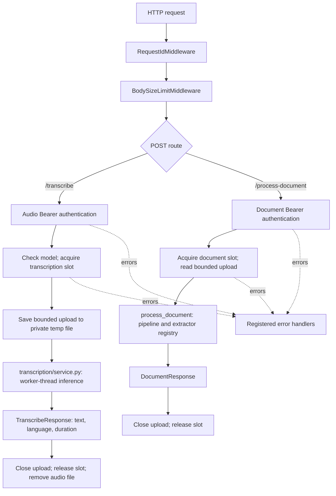

# audiodoc Architecture

## 1. Purpose and request flow

audiodoc is a separate FastAPI service used by the Telegram bot. It accepts audio for Whisper transcription and office/document files for text extraction. The bot remains an HTTP client; animation, image, and video processing remain on the bot side.

Document flow:

1. `RequestIdMiddleware` validates or generates `X-Request-ID` and makes it available through a `contextvars.ContextVar`.
2. `BodySizeLimitMiddleware` limits the whole request body before multipart parsing.
3. `api/documents.py` validates the dedicated Bearer key, reserves a bounded queue slot before copying the upload, and reads the `file` field with the file-size limit.
4. `document_engine/runner.py` sends synchronous extraction to a worker thread and keeps the slot until the worker has actually finished.
5. `pipeline.py` checks input size/type, validates ZIP containers, creates `ExtractContext`, and invokes the extractor from `extractors.REGISTRY`.
6. Extractors share a `TextBudget` and `Deadline`; `result.py` creates the JSON response.

Audio flow:

1. `api/transcribe.py` validates the separate Whisper key and model state.
2. A bounded transcription queue reserves capacity before the upload is copied to a private temporary file.
3. `transcription/service.py` runs inference in a worker thread, checks the decoded duration, and returns `text`, `language`, and `duration`.
4. The temporary audio file is deleted by `temp_audio_file()` even when processing fails.

## 2. Application startup and shutdown

`audiodoc/cli.py` is the supported command-line entry point. `audiodoc run` loads the selected environment file before validating settings and starts Uvicorn with `audiodoc.main:create_app` and `factory=True`. `audiodoc/main.py` does not load `.env`; `create_app()` reads the process environment through `get_settings()` unless an explicit `Settings` object is supplied. `app.py` remains a compatibility entry point for `uvicorn app:app`.

During lifespan startup the service sets `umask(077)`, verifies that the API keys are configured unless the explicit local-only bypass is enabled, creates a private temporary directory, removes stale service-owned audio files, and loads the Whisper model in a worker thread. The process is shut down by the ASGI server; the model is released with the process.

### Settings, factory, and CLI

`Settings` is a frozen dataclass. `load_settings(environ)` parses and validates values; `get_settings()` caches process-environment settings. Canonical keys are `AUDIODOC_AUDIO_KEY` and `AUDIODOC_DOCUMENT_KEY`; legacy key names remain compatibility aliases.

`audiodoc run` loads its env file, builds validated settings, configures logging, and starts Uvicorn. Other CLI commands are `version`, `doctor`, `init`, `pair`, `model download`, `config check`, and `service install`.

`create_app(settings=None)` accepts explicit settings or calls `get_settings()`. It stores `settings`, `transcription_queue`, and `document_queue` on `app.state`; lifespan creates `model_holder`, loads Whisper, then starts both queues. Shutdown stops both queues. `ENABLE_DOCS` controls the OpenAPI and Swagger routes.

### Request flow

`RequestIdMiddleware` is outermost; the body-size middleware rejects oversized bodies before route processing. Route authentication, bounded queue admission, upload limits, and cleanup are endpoint-specific.



## 3. HTTP layer

| Method and path | Purpose | Authentication |
| --- | --- | --- |
| `GET /health` | Liveness and Whisper model state | None |
| `GET /ready` | Tesseract, OCR languages, DjVuLibre and model diagnostics | `AUDIODOC_DOCUMENT_KEY` |
| `POST /transcribe` | Audio transcription | `AUDIODOC_AUDIO_KEY` |
| `POST /process-document` | Document text extraction | `AUDIODOC_DOCUMENT_KEY` |

The two POST routes accept `multipart/form-data` with a required `file` field. `/process-document` also accepts optional `max_characters`, which can reduce the server's extraction budget. Successful response models retain the bot-required fields; the optional `truncated` field is additive.

`/health` is a liveness endpoint and intentionally does not verify optional native parsers. Use authenticated `/ready` to inspect Tesseract, installed language data, all three DJVU tools, and `model_loaded`. The endpoint reports diagnostics; it does not automatically install or repair missing packages.

`RequestIdMiddleware` accepts only request IDs matching `[A-Za-z0-9._-]{8,64}`. Invalid or absent values are replaced with a UUID. The identifier is echoed in the `X-Request-ID` response header and added to log records. The context variable is inherited by `asyncio.to_thread` workers.

Typed `BackendError` exceptions are mapped to safe public messages and status codes. Unexpected exceptions are logged server-side and return a generic 500 response. `SecretsFilter` redacts configured API keys, Telegram-like token strings, and logged Bearer values from messages and tracebacks.

## 4. Whisper

`audiodoc/transcription/model.py` provides `ModelHolder`, which loads one `faster-whisper` model. `service.py` executes model inference outside the event loop and uses a bounded `WorkQueue`. Model selection, device, compute type, thread count, language, beam size, and offline mode are configured through environment variables.

For an offline deployment, pre-download the model to a local directory and set `WHISPER_MODEL_PATH` and `WHISPER_OFFLINE=true`. `local_files_only=true` prevents an implicit model download. The machine must still have all model files and runtime dependencies installed before network egress is blocked.

`temp_files.py` creates a private directory and files with restrictive permissions. Files use generated names and are deleted after processing; stale cleanup only touches files matching the service's own naming convention.

## 5. Document Engine

`audiodoc/document_engine/` is independent of the HTTP layer, transcription, and configuration packages.

Processing order is detection → container guards → extractor registry → result. Supported formats are PDF, DOCX, XLSX, PPTX, ODT, ODS, ODP, EPUB, FB2, DJVU, TXT, MD, HTML, XML, CSV, and RTF. PDF pages without a text layer and scanned DJVU use Tesseract OCR. Standalone images and legacy binary Office formats are unsupported.

Extractors receive an `ExtractContext` with a shared character budget, monotonic deadline, and filename. Table iterators have independent row/column caps. PDF rendering calculates a safe DPI before allocating the raster image; OCR checks dimensions before copying frames; DJVU process output, time, render dimensions, and TIFF size are bounded.

## 6. Limits and security boundaries

- Audio and document routes use distinct Bearer keys. Startup fails closed unless both are configured or `ALLOW_UNAUTHENTICATED=true` is deliberately enabled for local development.
- Audio uploads default to 25 MiB and 600 seconds. Document uploads default to 50 MiB and 500 pages.
- Document extraction defaults to a 180-second deadline, two concurrent documents, a finite waiting queue, and a 2,000,000-character server budget. A client may further reduce the text budget through `max_characters`.
- ZIP member count, decompressed size, individual member size, and compression ratio are capped. XLSX/ODS ranges, PDF/DJVU rendering, OCR images, and external program output are also limited.
- The code does not configure a public network bind. Bind Uvicorn to a private/VPN address or loopback behind a TLS proxy; apply the `deploy/` examples only after adapting them to the actual network and host.
- The systemd example runs the process as an unprivileged account, makes application files read-only, grants write access only to the temp directory, sets resource quotas, and blocks service egress except explicit private addresses.

## 7. Logging and request correlation

The root logger uses a consistent format with the request ID. The request ID is generated or validated by middleware and is echoed to the caller. `SecretsFilter` is attached to root handlers so messages from this project and third-party libraries pass through redaction. Do not log uploaded content, extracted text, transcripts, authorization headers, or uncleaned filenames. Under systemd, logs are available through `journalctl -u audiodoc`.

## 8. Dependencies and package layout

- `api/`: HTTP routers, response schemas, authentication, middleware and error handling.
- `common/`: deadlines, queues, limited uploads/subprocesses, safe logging, request IDs and logging setup.
- `config/`: environment-backed settings and project paths.
- `document_engine/`: limits, detection, guards, OCR, extractors and pipeline.
- `errors/`: typed errors with safe public messages.
- `transcription/`: Whisper model, threaded recognition and temporary files.
- `tests/`: contract, unit and integration checks.

```text
audiodoc/
├── app.py
├── audiodoc/
│   ├── api/
│   ├── common/
│   ├── config/
│   ├── document_engine/
│   │   ├── detection/
│   │   ├── extractors/
│   │   ├── guards/
│   │   ├── ocr/
│   │   ├── pipeline.py
│   │   ├── result.py
│   │   └── runner.py
│   ├── errors/
│   ├── transcription/
│   └── main.py
├── deploy/
├── docs/
├── tests/
├── .env.example
├── pytest.ini
├── requirements.txt
├── requirements-dev.txt
└── requirements-lock.txt
```
