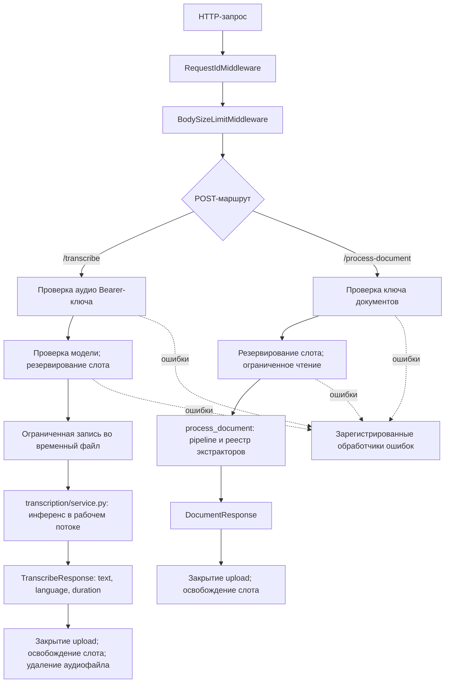

# Архитектура audiodoc

## 1. Назначение и поток запроса

audiodoc — отдельный FastAPI-сервис для Telegram-бота. Он принимает аудио для распознавания Whisper и документы для извлечения текста. Бот остаётся HTTP-клиентом; обработка изображений, анимаций и видео остаётся на стороне бота.

Поток документа:

1. `RequestIdMiddleware` проверяет или создаёт `X-Request-ID` и сохраняет его в `contextvars.ContextVar`.
2. `BodySizeLimitMiddleware` ограничивает всё тело HTTP-запроса до разбора multipart.
3. `api/documents.py` проверяет отдельный Bearer-ключ, резервирует место в конечной очереди до копирования файла и читает поле `file` с ограничением размера.
4. `document_engine/runner.py` запускает синхронный pipeline в рабочем потоке и удерживает слот очереди до фактического завершения потока.
5. `pipeline.py` проверяет размер и формат, проверяет ZIP-контейнеры, создаёт `ExtractContext` и вызывает экстрактор из `extractors.REGISTRY`.
6. Экстракторы используют общий `TextBudget` и `Deadline`; `result.py` формирует JSON-ответ.

Поток аудио:

1. `api/transcribe.py` проверяет отдельный ключ Whisper и состояние модели.
2. Конечная очередь резервирует место до копирования загрузки во временный файл с закрытыми правами.
3. `transcription/service.py` выполняет распознавание в рабочем потоке, проверяет длительность декодированного аудио и возвращает `text`, `language`, `duration`.
4. `temp_audio_file()` удаляет временный файл и при успешной обработке, и при ошибке.

## 2. Создание, запуск и остановка

`audiodoc/cli.py` — основная точка входа командной строки. Команда `audiodoc run` загружает выбранный env-файл до проверки настроек и запускает Uvicorn через `audiodoc.main:create_app` с `factory=True`. `audiodoc/main.py` не загружает `.env`: без явно переданного объекта `Settings` функция `create_app()` читает настройки процесса через `get_settings()`. `app.py` сохраняет совместимость с `uvicorn app:app`.

Во время startup lifespan сервис устанавливает `umask(077)`, проверяет наличие ключей (кроме явно разрешённого локального режима), создаёт приватный временный каталог, удаляет устаревшие аудиофайлы сервиса и загружает Whisper в рабочем потоке. При завершении ASGI-процесса модель освобождается вместе с процессом.

### Настройки, фабрика приложения и CLI

`Settings` — неизменяемый dataclass. `load_settings(environ)` разбирает и проверяет значения окружения, а `get_settings()` кэширует настройки текущего процесса. Канонические ключи авторизации — `AUDIODOC_AUDIO_KEY` и `AUDIODOC_DOCUMENT_KEY`; старые имена сохранены как совместимые псевдонимы.

`audiodoc run` загружает env-файл, проверяет настройки, конфигурирует логирование и запускает Uvicorn. Остальные команды CLI: `version`, `doctor`, `init`, `pair`, `model download`, `config check` и `service install`.

`create_app(settings=None)` принимает явные настройки либо вызывает `get_settings()`. Фабрика сохраняет `settings`, `transcription_queue` и `document_queue` в `app.state`. Во время lifespan создаётся `model_holder`, загружается Whisper, затем запускаются обе очереди. При shutdown обе очереди останавливаются. Параметр `ENABLE_DOCS` управляет доступностью OpenAPI и Swagger.

### Поток HTTP-запросов

`RequestIdMiddleware` является внешним middleware; ограничение размера тела отклоняет слишком большие запросы до обработки маршрута. Авторизация, резервирование места в ограниченной очереди, лимиты загрузки и очистка ресурсов выполняются отдельно для каждого маршрута.



## 3. HTTP-слой

| Метод и путь | Назначение | Авторизация |
| --- | --- | --- |
| `GET /health` | Liveness и состояние загрузки Whisper | Не требуется |
| `GET /ready` | Tesseract, языки OCR, DjVuLibre и состояние модели | `AUDIODOC_DOCUMENT_KEY` |
| `POST /transcribe` | Распознавание аудио | `AUDIODOC_AUDIO_KEY` |
| `POST /process-document` | Извлечение текста из документа | `AUDIODOC_DOCUMENT_KEY` |

Оба POST-маршрута принимают `multipart/form-data` с обязательным полем `file`. `/process-document` также принимает необязательное `max_characters`, которое может только уменьшить серверный бюджет символов. Обязательные поля успешных ответов сохраняют совместимость с ботом; дополнительное `truncated` обратно совместимо.

`/health` — liveness и намеренно не проверяет необязательные нативные парсеры. Для диагностики используйте `/ready` с ключом документов: он показывает наличие Tesseract, установленные языки, все три инструмента DjVuLibre и `model_loaded`. Endpoint сообщает состояние, но сам не устанавливает и не исправляет пакеты.

`RequestIdMiddleware` принимает только `X-Request-ID`, соответствующий `[A-Za-z0-9._-]{8,64}`. Отсутствующий или некорректный идентификатор заменяется UUID. Значение возвращается в заголовке ответа и добавляется в каждую запись лога. Контекст наследуется рабочими потоками `asyncio.to_thread`.

Типизированные `BackendError` преобразуются в безопасные публичные сообщения и HTTP-коды. Неожиданные исключения записываются в серверный журнал, а клиент получает общий `500`. `SecretsFilter` удаляет из сообщений и traceback настроенные API-ключи, токены Telegram-подобного формата и значения в заголовке Bearer.

## 4. Whisper

`audiodoc/transcription/model.py` содержит `ModelHolder`, который загружает одну модель `faster-whisper`. `service.py` выполняет инференс вне event loop и использует конечную `WorkQueue`. Модель, устройство, тип вычислений, число CPU-потоков, язык, beam size и офлайн-режим задаются переменными окружения.

Для офлайн-развёртывания заранее скачайте модель в локальный каталог, задайте `WHISPER_MODEL_PATH` и `WHISPER_OFFLINE=true`. Параметр `local_files_only=true` запрещает неявное скачивание модели. До блокировки сети на диске должны находиться все файлы модели и должны быть установлены все runtime-зависимости.

`temp_files.py` создаёт приватный каталог и файлы с ограниченными правами. Файлы имеют сгенерированные имена и удаляются после обработки; очистка при старте затрагивает только файлы с шаблоном имён этого сервиса.

## 5. Document Engine

`audiodoc/document_engine/` не зависит от HTTP-слоя, транскрибации и конфигурации.

Порядок обработки: детекция → защитные проверки контейнеров → реестр экстракторов → результат. Поддерживаются PDF, DOCX, XLSX, PPTX, ODT, ODS, ODP, EPUB, FB2, DJVU, TXT, MD, HTML, XML, CSV и RTF. Для PDF без текстового слоя и сканированного DJVU применяется Tesseract OCR. Отдельные изображения и старые бинарные форматы Office не поддерживаются.

Экстракторы получают `ExtractContext` с общим бюджетом символов, монотонным дедлайном и именем файла. Для табличных диапазонов заданы отдельные лимиты строк и столбцов. Безопасный DPI страницы PDF рассчитывается до выделения растра; OCR проверяет размеры до копирования кадра; вывод внешних программ, время, размер рендера и TIFF DJVU ограничены.

## 6. Лимиты и границы безопасности

- Аудио и документы защищены разными Bearer-ключами. По умолчанию запуск запрещён при отсутствии ключей; исключение — сознательно включённый `ALLOW_UNAUTHENTICATED=true` для локальной разработки.
- Аудио по умолчанию ограничено 25 МиБ и 600 секундами. Документ — 50 МиБ и 500 страницами.
- Для документов по умолчанию заданы общий дедлайн 180 секунд, два параллельных обработчика, конечная очередь ожидания и бюджет 2 000 000 символов. Клиент может дополнительно уменьшить бюджет через `max_characters`.
- Отдельно ограничиваются число ZIP-членов, распакованный размер, размер отдельного члена и коэффициент сжатия. Также ограничены таблицы, рендеринг PDF/DJVU, изображения OCR и вывод внешних программ.
- Код не настраивает публичный сетевой bind. Uvicorn должен слушать приватный/VPN-адрес либо loopback за TLS-прокси; файлы из `deploy/` применяйте только после адаптации к своей сети и серверу.
- Пример systemd запускает службу без root, закрывает код от записи, разрешает запись только во временный каталог, ограничивает ресурсы и блокирует исходящую сеть, кроме заданных приватных адресов.

## 7. Логи и идентификаторы запросов

Корневой логгер использует единый формат с `request_id`. Middleware создаёт или проверяет идентификатор и возвращает его клиенту. `SecretsFilter` установлен на root handlers, поэтому фильтрацию проходят записи проекта и сторонних библиотек. Нельзя писать в логи содержимое загрузок, извлечённый текст, транскрипции, заголовки авторизации и неочищенные имена файлов. Под systemd записи доступны командой `journalctl -u audiodoc`.

## 8. Зависимости и дерево пакетов

- `api/` — HTTP-роутеры, схемы ответов, авторизация, middleware и обработчики ошибок.
- `common/` — дедлайны, очереди, ограниченные загрузки/подпроцессы, безопасные логи, request ID и настройка логирования.
- `config/` — настройки из окружения и пути проекта.
- `document_engine/` — лимиты, детекция, защитные проверки, OCR, экстракторы и pipeline.
- `errors/` — типизированные ошибки с безопасными публичными сообщениями.
- `transcription/` — модель Whisper, потоковое распознавание и временные файлы.
- `tests/` — contract-, unit- и integration-тесты.

```text
audiodoc/
├── app.py
├── audiodoc/
│   ├── api/
│   ├── common/
│   ├── config/
│   ├── document_engine/
│   │   ├── detection/
│   │   ├── extractors/
│   │   ├── guards/
│   │   ├── ocr/
│   │   ├── pipeline.py
│   │   ├── result.py
│   │   └── runner.py
│   ├── errors/
│   ├── transcription/
│   └── main.py
├── deploy/
├── docs/
├── tests/
├── .env.example
├── pytest.ini
├── requirements.txt
├── requirements-dev.txt
└── requirements-lock.txt
```
